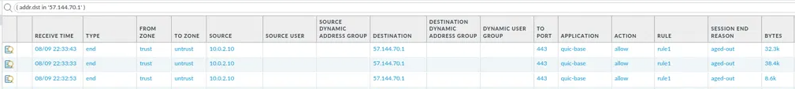
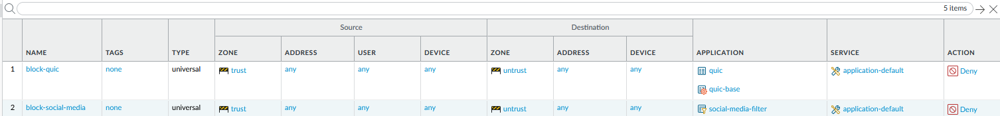
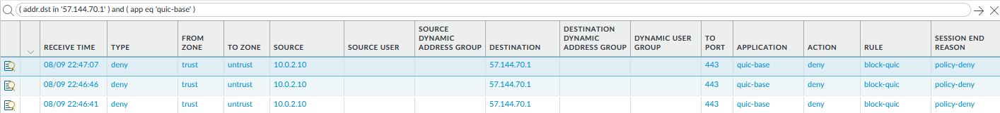

I could probably bet my first born child that almost everyone reading this post has once created a firewall policy, thought it would be all sunshine and rainbows, then you hit the commit button and it just craps out. DNS breaks, users are upset, mailman is on fire. The world is ending.

I inadvertently put myself in this situation when experimenting with a PA-VM and application filters. What started off as trying to block social media turned into a nightmare digging into logs. But what I found was interesting.

SaaS applications like Facebook and Google have been preferring the use of QUIC over typical TLS for HTTPS traffic. For those that don't know what QUIC is, it's a protocol created by Google that enforces encryption at every step of the packet. It uses UDP too, so its much faster than your typical TLS packet.

However, due to the nature of the encryption, NGFW's cannot inspect QUIC traffic like it can with normal HTTPS/TLS traffic (due to the TLS handshake). This theory is proven below:



This image shows my source IP, `10.0.2.10`, establishing a successful connection with the Facebook servers, `57.144.70.1` using `quic-base`. Since `quic-base` was not in my existing application filter, we have some options:

1. Explicitly deny `quic-base` in a security policy.
2. Create an application filter containing `quic-base` and attach it to a similar security policy:

```
rule: block-quic
source zone: trust
dest zone: untrust
application: quic-base, quic
service: application-default
action: deny
```
I would also recommend positioning this rule above existing rules so regular TLS is enforced before routing to your other policies.



After remediation, let's test:



Success! The QUIC protocol now blocked network-wide and TLS is forced. At this point, DPI becomes  easier and policies will be much more effective.