This weekend I finally got around to standing up Microsoft Configuration Manager (MECM, or SCCM if you've been in IT longer than five minutes) in my homelab. It's a project I've wanted to tackle for about a year, and I finally pulled the trigger.

The install wizard was the easy part. Afterward the site flat out refused to start and threw `Unknown SQL Error` every five seconds. It took me a full evening of digging through logs to pin it on a single ODBC driver update.

This post will cover building the site, plus how I troubleshot the ODBC issue. In future posts, I'll show how to add clients and layer on more security (like swapping the SQL service account for a gMSA and retiring the client push account).

You might be asking, why bother with MECM in 2026? Intune exists, so is it even worth learning? A ton of shops still run it, usually co-managed with Intune. Besides, according to a 2025 article by DuploCloud, approximately 80% of organizations are still running a hybrid architecture.

## Resources

Everything I used, straight from Microsoft. Grab it all before you start and keep it on your data drive with the version in the filename. Two of these links died on me mid-build, so trust me on this one.

**Downloads**

| What | Where | Notes |
| --- | --- | --- |
| Windows Server 2025 (eval) | [Evaluation Center](https://www.microsoft.com/evalcenter/download-windows-server-2025) |  |
| SQL Server 2022 Developer | [Visual Studio Dev Essentials](https://visualstudio.microsoft.com/dev-essentials/) | Free account. Grab the full ISO, **not** SQL 2025 |
| SQL Server Management Studio | [Install SSMS](https://learn.microsoft.com/ssms/install/install) | Optional, but you'll want it for memory settings and checking the DB |
| ODBC Driver 18 | [Download page](https://learn.microsoft.com/sql/connect/odbc/download-odbc-driver-for-sql-server) + [release notes](https://learn.microsoft.com/sql/connect/odbc/windows/release-notes-odbc-sql-server-windows) | Use **18.6.2.1**, not 18.7.1.1. Older versions are linked from the release notes |
| Windows ADK + WinPE add-on | [Download the ADK](https://learn.microsoft.com/windows-hardware/get-started/adk-install) | Both downloads have to be the same version |
| Configuration Manager (eval) | [Evaluation Center](https://www.microsoft.com/evalcenter/evaluate-microsoft-endpoint-configuration-manager) | Current branch, time limited. The console title bar shows how many days you have left |

**Docs worth bookmarking**

- [Supported SQL Server versions for Configuration Manager](https://learn.microsoft.com/mem/configmgr/core/plan-design/configs/support-for-sql-server-versions)
- [Supported configurations for Configuration Manager](https://learn.microsoft.com/mem/configmgr/core/plan-design/configs/supported-configurations)
- [The ODBC 18.7.1.1 Tech Community thread](https://techcommunity.microsoft.com/discussions/configurationmanager/latest-odbc-driver-18-for-sql-18-7-1-1-breaks-sccm-site-server--sql-connectivity/4555392)

## The Hardware

Everything runs on a Dell OptiPlex 7000 Micro (i7-12700T, 64 GB RAM, 500 GB NVMe) running Proxmox.

| VM | Role | Resources |
| --- | --- | --- |
| Domain controller | AD DS + DNS | 4 GB RAM |
| CM site server | Primary site, SQL Server, management point, distribution point | 4 vCPU, 16 GB RAM, 80 GB OS + 150 GB data |
| Clients | Windows 11 Pro desktop, and a throwaway Win11 VM for breaking things | n/a |

There's a lot of flexibility in building this out. Many organizations would prefer to have SQL Server on its own VM. Of course, resource allocation also depends heavily on the number of clients you have. In my case, I won't have more than 10 at any given time.

## Step 1: The site server VM

Windows lives on the 80 GB `C:` drive, and pretty much everything else (SQL databases, content library, CM logs) lives on a separate 150 GB `D:`.

Some quick notes:

- I formatted `D:` with NTFS and 64K clusters. SQL reads and writes in 64 KB extents, so the filesystem should match. Running `fsutil fsinfo ntfsinfo D:` should report 65536 bytes per cluster.

- I would also recommend adding a blank `NO_SMS_ON_DRIVE.SMS` file to the root of `C:`. This tells CM to never put content on that drive. Don't be like me and forget it the first time.

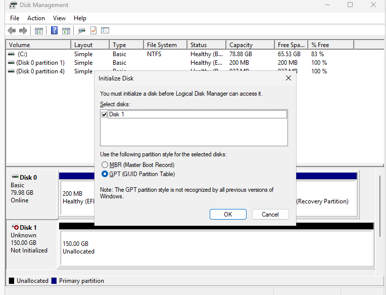

## Step 2: Active Directory prep

- I created a `CM-Admins` group for console and SQL admins, and a `CM-SiteServers` group that holds the site server's computer account. Every permission below goes to a group, not a person.

- Next, I created two service accounts: one for SQL and one for client push. Neither one is a domain admin.

- Before extending the schema, we need to create the container CM publishes to. In ADSI Edit, under `CN=System`, create a container named `System Management` and give `CM-SiteServers` Full Control on it and everything below. This is where the site publishes itself so clients can find it.

- To extend the AD schema, I'd recommend taking a snapshot of the DC first, since you can't undo it. In ADUC, add yourself to Schema Admins, sign out and back in so the new group membership actually applies, then run `extadsch.exe` from the Configuration Manager media. Once it's done, take yourself back out of Schema Admins.

The SQL service account also needs its SPNs registered by hand, since a normal account can't register its own:

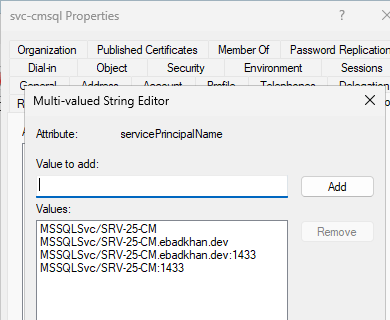

For those that don't know, any account with an SPN is Kerberoastable. Any domain user can request a service ticket for it and crack it offline. That's why this account gets a long, random password until I move it to a gMSA.

## Step 3: IIS and Windows features

The MP and DP are web services, so the site server needs IIS. In Add Roles and Features, add Web Server (IIS) with these role services:

* Windows Authentication
* ASP.NET 4.8
* .NET Extensibility 4.8
* ISAPI Extensions and Filters
* IIS 6 Metabase and WMI Compatibility
* IIS management scripts and tools

Then on the features page, grab:

* .NET Framework 3.5
* BITS (with the IIS Server Extension)
* Remote Differential Compression
* WCF HTTP Activation

I skipped .NET Framework 3.5. Again, do not be like me. Without it, CM's setup launcher won't even open:

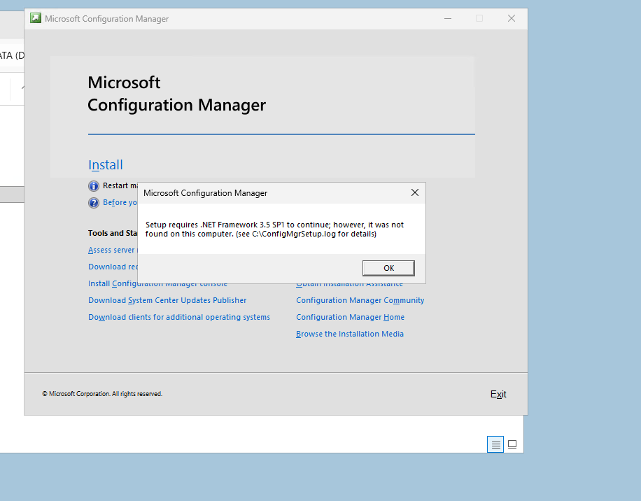

This should go without saying, but to limit your attack surface, stick to these and whatever else you actually need.

## Step 4: SQL Server 2022 Developer

Microsoft's SQL page now pushes **SQL Server 2025**, but the CM baseline I installed from (2509) doesn't support it. 2025 support comes in an update you can only apply after the site already exists. On top of that, both of the old SQL 2022 bootstrappers are dead:

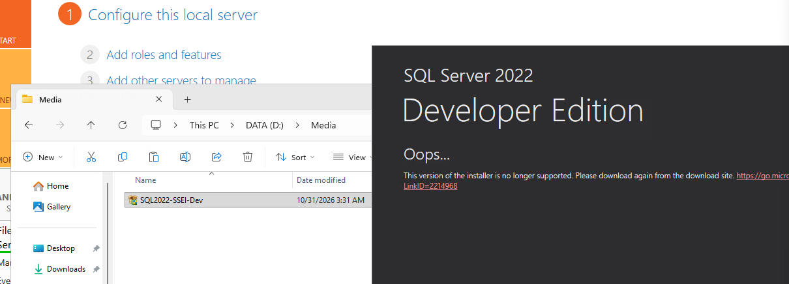

I grabbed the full SQL Server 2022 Developer ISO from Visual Studio Dev Essentials, which is free. Stick to Microsoft's own download. This is going on a server that holds the keys to every managed machine, so don't grab an ISO from some random mirror.

In setup:

1. **Database Engine Services only.** No replication, full-text, PolyBase, or anything else.

    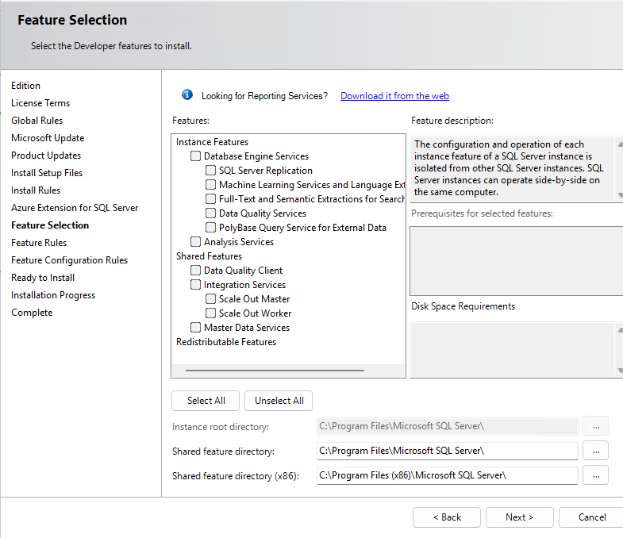

2. **Service accounts.** The engine runs as the domain SQL service account. SQL Agent keeps its virtual account, but set it to **Automatic** since CM depends on Agent jobs. Leave SQL Browser disabled.

    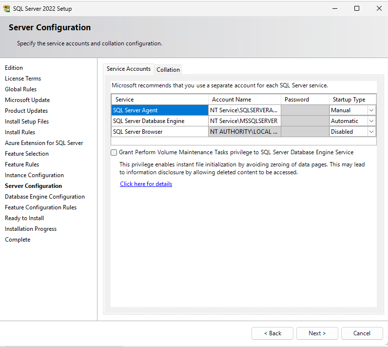

3. **Collation `SQL_Latin1_General_CP1_CI_AS`.** You can't change this later without reinstalling, so get it right the first time.

4. **Windows authentication only**, with `CM-Admins` and `CM-SiteServers` as sysadmins.

5. **Data, logs, backup, and tempdb all on `D:`.**

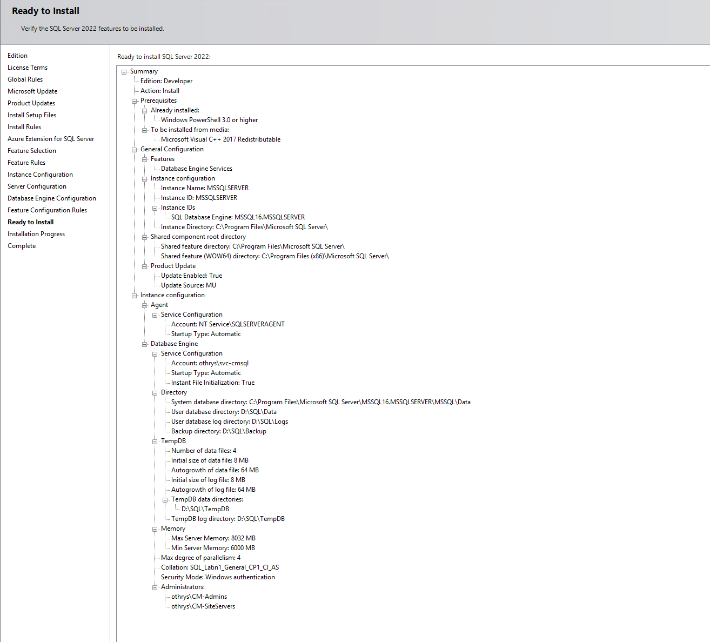

After the install, set min and max server memory to 8192 MB (CM wants at least 8 GB reserved for SQL). One gotcha: Developer edition ships with **TCP/IP disabled**. SSMS on the server works fine because it uses shared memory, but CM setup connects over TCP and fails. Enable TCP/IP in SQL Server Configuration Manager, set it to port 1433, and restart SQL.

## Step 5: Windows ADK and WinPE

Let's do a quick recap of what we've done so far. We created service accounts and groups in Active Directory and extended the schema, so all the relevant Configuration Manager objects can live neatly in our environment. We then installed the prerequisite roles on our Configuration Manager server and installed SQL Server 2022. Now that we're up to speed, let's keep going.

Next up is the Windows ADK, with only **Deployment Tools** and **User State Migration Tool**, then the WinPE add-on. The two versions have to match exactly or the boot images will break later when you get into OS deployment.

## Step 6: The CM setup wizard

YAY! Now the fun part. We'll be running the CM installer! Find `splash.hta` in the extracted CM media, choose **Install a Configuration Manager primary site**, and **uncheck typical installation**. Typical picks defaults for you (like installing everything to `C:`). Unchecked, you see and choose every setting yourself.

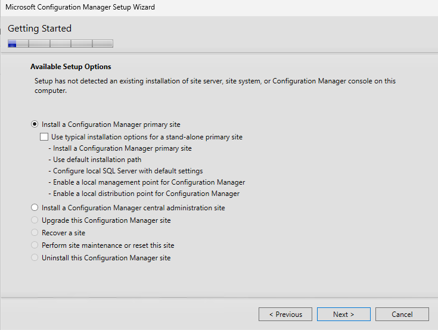

The choices that matter:

- **Site code.** Three characters and it's permanent. Mine is `OTH`.
- **Install folder on `D:`.** CM's logs live inside it, and a log flood shouldn't be able to fill up the OS drive.
- **Stand-alone primary site.** A central administration site is only for very large, multi-site environments.
- **Database** on the site server's FQDN, default instance, Service Broker on port 4022. This is where the TCP/IP gotcha from Step 4 bit me:

    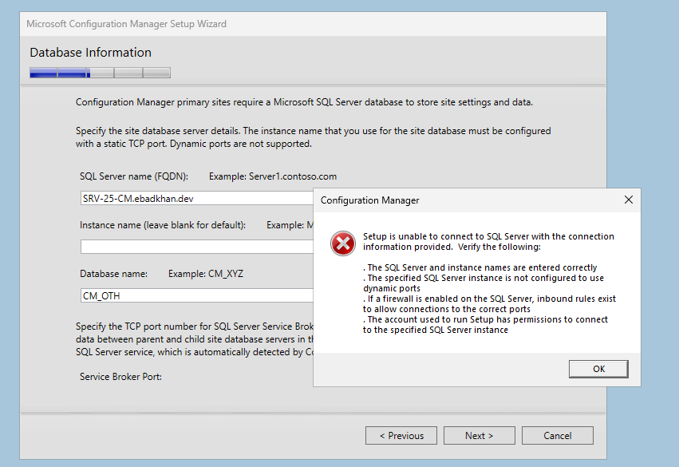

- **Client communication:** configure per role. The MP and DP use Enhanced HTTP, where CM issues its own certificates, so you don't need a PKI yet.
- **Service connection point** on. Without it, the site can't download its own updates.

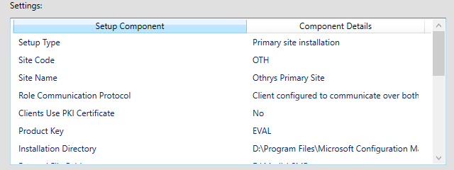

The prerequisite check came back with five warnings and zero errors. Read every single warning instead of clicking through. Mine were:

1. WSUS missing. I skipped it on purpose.
2. AD publish permissions. False positive, since the check can't evaluate group-based permissions.
3. SQL Native Client version. Already on the latest build.
4. SQL security mode. Another false positive. SQL's own log confirmed it was Windows auth only.
5. SQL memory. This one was real, and I fixed it afterward.

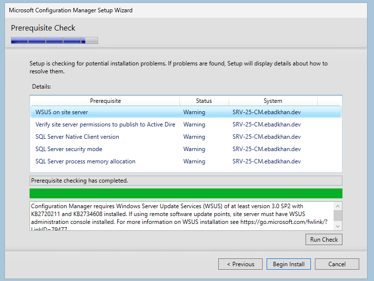

Then hit Begin Install and watch `C:\ConfigMgrSetup.log` in CMTrace for 30 to 60 minutes. Mine finished with all green checkmarks.

## But then, the site wouldn't start

Setup said it completed. The console said otherwise:

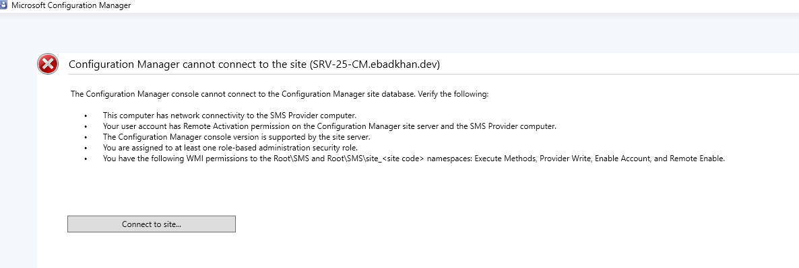

The `SMS_EXECUTIVE` service (CM's main engine) never got installed. `sitecomp.log` shows why:

```
*** *** Unknown SQL Error!
*** Failed to connect to the SQL Server, connection type: SMS ACCESS.
CSiteControlEx::GetSCF:Failed to read site information from database, retry in 5 seconds ...
```

At this point, I dug into practically every layer I could think of:

| Layer | Test | Result |
| --- | --- | --- |
| SQL itself | SQL ERRORLOG | Healthy, listening on 1433, Windows-only auth, **zero failed logins** |
| Kerberos | SPNs on the service account and computer, `setspn -X` | Correct, no duplicates, no Kerberos errors |
| TLS | System log, Schannel | No errors |
| Identity | ODBC test **as SYSTEM** with `PsExec -s -i odbcad32.exe`, encryption + cert validation on | **Passed** |
| Old driver | Same test through the legacy SQL Server driver and CM's own DSN | Passed |
| Native Client | SNAC version | Already the latest build |
| CM's view | `SqlEnabled` SQL tracing in the registry | Still nothing beyond "Unknown" |

The SYSTEM test was the turning point. CM's services run as SYSTEM, and SYSTEM could connect just fine. Encrypted, cert validated, straight into the CM database:

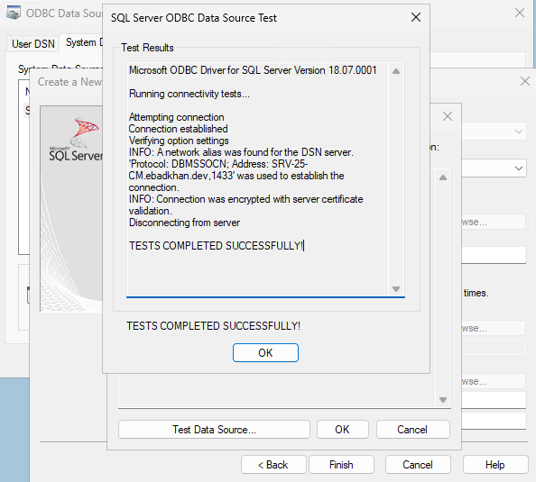

Same identity, same server, same driver, and it worked. So the problem wasn't the connection, it was something about CM's process. The failures were happening in about 10 ms with no login attempt at all. I had a gut feeling this was a crash and not a typical login rejection.

I opened Event Viewer, and the **Application** log was packed with COM+ event 4786, one every five seconds:

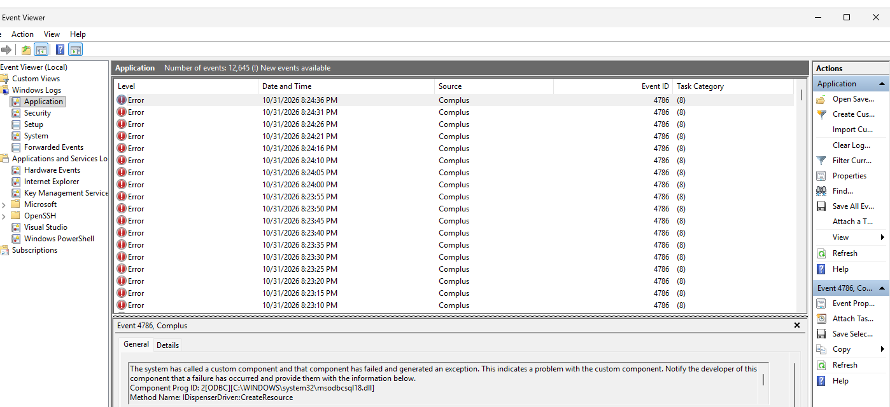

> Component Prog ID: [ODBC][C:\WINDOWS\system32\msodbcsql18.dll], Method Name: IDispenserDriver::CreateResource

The ODBC driver was **crashing** inside CM's connection pool, which is why CM never got an actual error to report.

Searching that exact text turned up a [Microsoft Tech Community thread](https://techcommunity.microsoft.com/discussions/configurationmanager/latest-odbc-driver-18-for-sql-18-7-1-1-breaks-sccm-site-server--sql-connectivity/4555392): ODBC Driver 18 **version 18.7.1.1** breaks site server to SQL connectivity. The crash happens in the Visual C++ runtime. The new driver doesn't play nice with the older runtime CM loads from its own folder. My manual tests loaded the system's newer runtime, so they passed.

And sure enough:

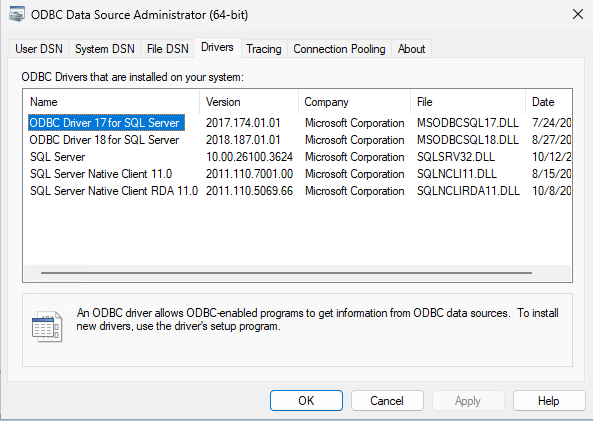

The fix: uninstall 18.7.1.1, install **18.6.2.1** from Microsoft's previous releases page, and reboot. A few minutes later:

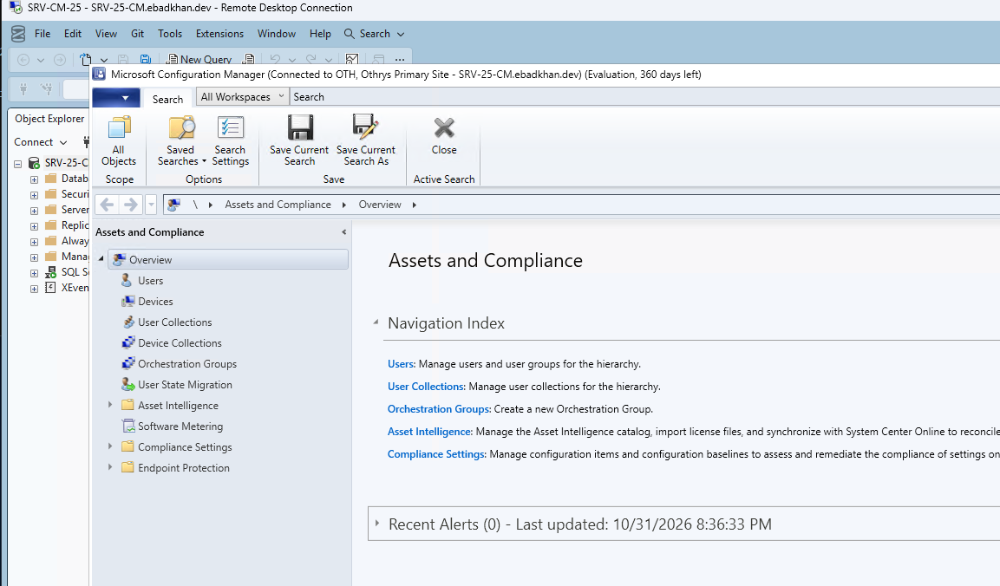

## Verifying Health Status

A console that connects isn't proof of a healthy site, so I went through the status views.

**Site Status** was all green, but the distribution point showed up twice, on both `C$` and `D$`. This is because I forgot to add `NO_SMS_ON_DRIVE.SMS` to my `C:`. Once I created it, the `C$` row dropped off on the next scan.

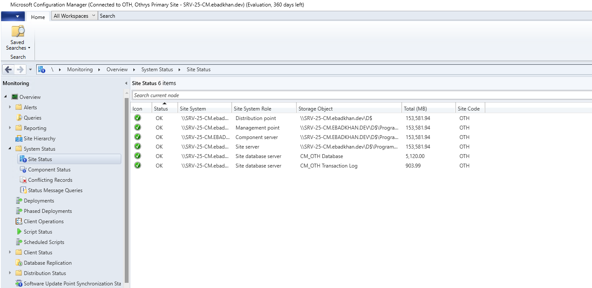

**Component Status** showed 57 of 60 components OK and three warnings:

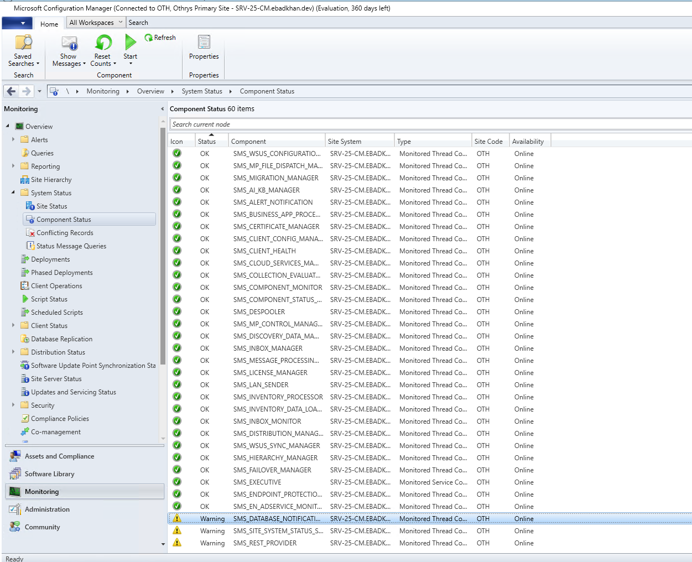

Before hitting Reset Counts, I read the messages. They were leftover noise from the bad startup. The AdminService (CM's REST API) had logged "failed to bind SSL certificate" twice during boot while fighting IIS for port 443, then came online on its own. After resetting the counts and checking back in, everything was green!

## Fin

Our Configuration Manager server is now complete! There's definitely room for improvement, but as a starting point, we have a relatively secure instance we can use to fully experiment with everything MECM has to offer.
