In my [last post](/2026/11/02/standing-up-mecm/), I stood up MECM and promised I'd start adding clients. Well, I got a little ahead of myself. Before I could do anything fun with co-management, I needed my desktop to exist in Intune. One desktop. How hard could it be?

Six error codes, one DNS record, a Graph API call, and one very late night later, it's co-managed. This post covers the whole path, including the parts where I went the wrong way, because honestly those parts taught me the most.

If there's one theme here, it's this: **almost every default in this stack is the convenient one, not the secure one.** I'll call them out as we go.

## The lab

| What | Details |
| --- | --- |
| Domain | `ebadkhan.dev`, DC is `SRV-25-DC` |
| MECM | `SRV-25-CM`, primary site `OTH` (from the last post) |
| Client | `WIN-DESK`, Windows 11, domain joined, CM client already installed |
| Tenant | Personal M365 tenant with 1x Intune Plan 1 and 1x Entra ID P2 |
| Accounts | `me` (daily driver, synced, licensed) and a separate on-prem admin account that never gets synced |

Quick note on licensing: Intune Plan 1 is the cheapest way to get legit rights to Configuration Manager in a lab. Business Premium does **not** include ConfigMgr rights, even though it looks like the better bundle, so don't let that one fool you.

## Context

If your device is already domain-joined, you simply cannot navigate to Settings, Accounts, Access work or school, Connect. 

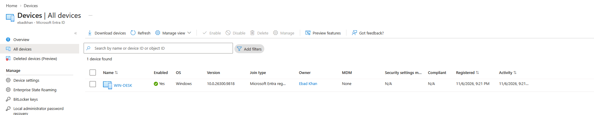

**Microsoft Entra registered**, with **MDM: None.** That's the BYOD path. For those that don't know, there are three join states, and they're basically trust levels:

| State | What it means | Who vouches for the device |
| --- | --- | --- |
| Entra registered | "This is my personal device" | The user |
| Entra joined | Cloud-only company device | Entra |
| Hybrid Entra joined | Company device that both AD and Entra know about | AD *and* Entra |

A domain-joined endpoint should be hybrid joined. Registered devices can't be co-managed. If you register *and* hybrid join the same machine, you end up with two device objects fighting each other.

## Step 1: Entra Connect Sync

### The service account
To get started, pull the Entra Connect Sync .exe file from the Entra admin center. Ideally, this should go on a machine that ISN'T your DC, but for lab purposes, this is fine.

For the default Virtual Service Account, I chose an sMSA account. Connect only ever runs on one box in my environment anyways.

```powershell
New-ADServiceAccount -Name msa-adsync -RestrictToSingleComputer
Add-ADComputerServiceAccount -Identity SRV-25-DC -ServiceAccount msa-adsync
Install-ADServiceAccount msa-adsync
Test-ADServiceAccount msa-adsync  
```

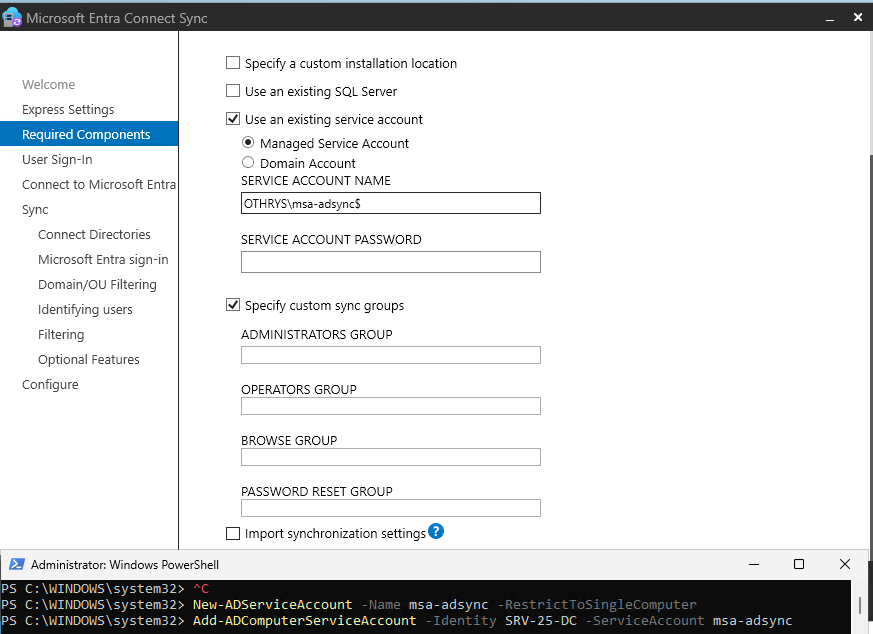

Two things that got me:

Connect Sync uses two different accounts. The **ADSync service account** is what the sync engine runs as. The **AD DS connector account** is what reads AD and pulls password hashes. The MSA only works for the first one.

### Sign-in method

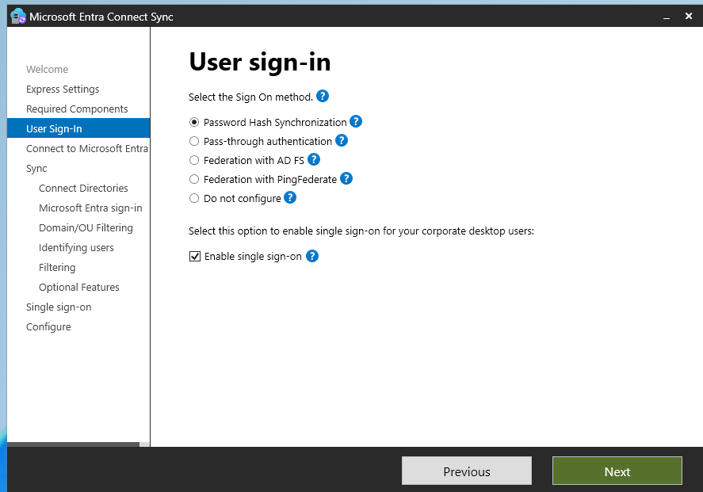

I went with **Password Hash Sync**. If my DC goes down, I can still sign into the cloud. On top of that, P2's leaked credential detection only works with PHS. Connect salts your hash and runs it through PBKDF2 before it ever leaves the building.

**Uncheck** the SSO option here. We don't need it...I don't need it.

You probably do.

### The connector account is basically domain admin

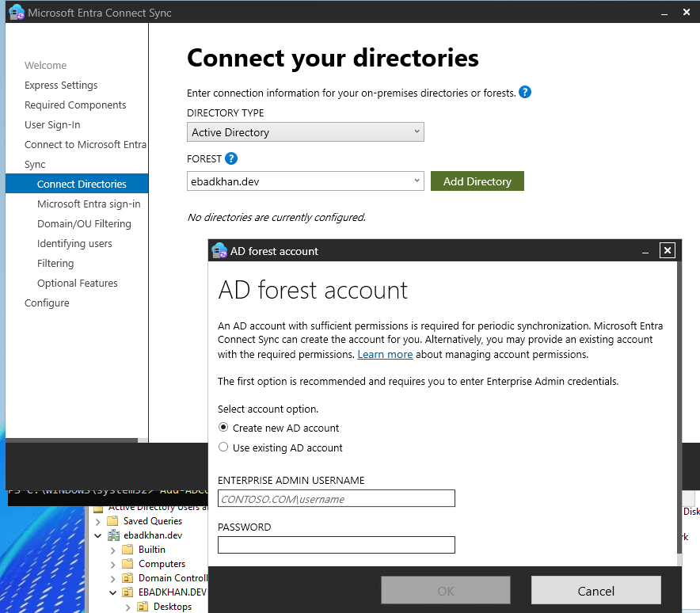

I let the wizard create the connector account (`MSOL_xxxxxxxx`) using temporary Enterprise Admin creds, then pulled myself back out of EA once I was done. What matters is what that account ends up with: **Replicating Directory Changes** and **Replicating Directory Changes All**.

That's DCSync. That account can pull every password hash in the domain, `krbtgt` included. 

### Adding my domain

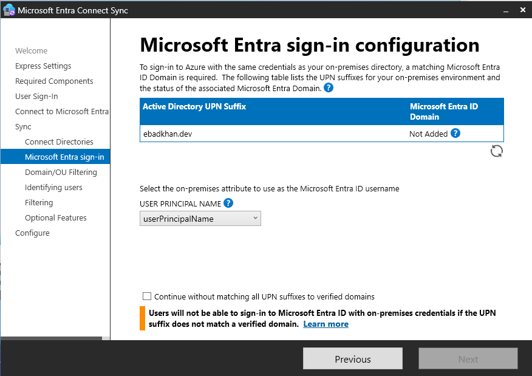

Connect won't sync `me@ebadkhan.dev` until the domain is verified in the tenant. That means a TXT record at my registrar:

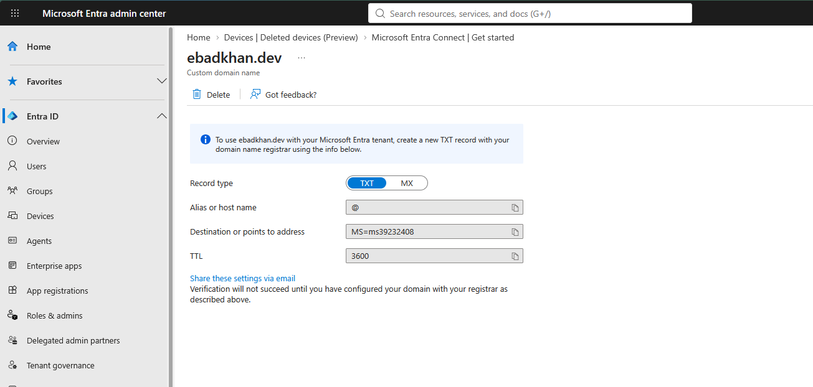

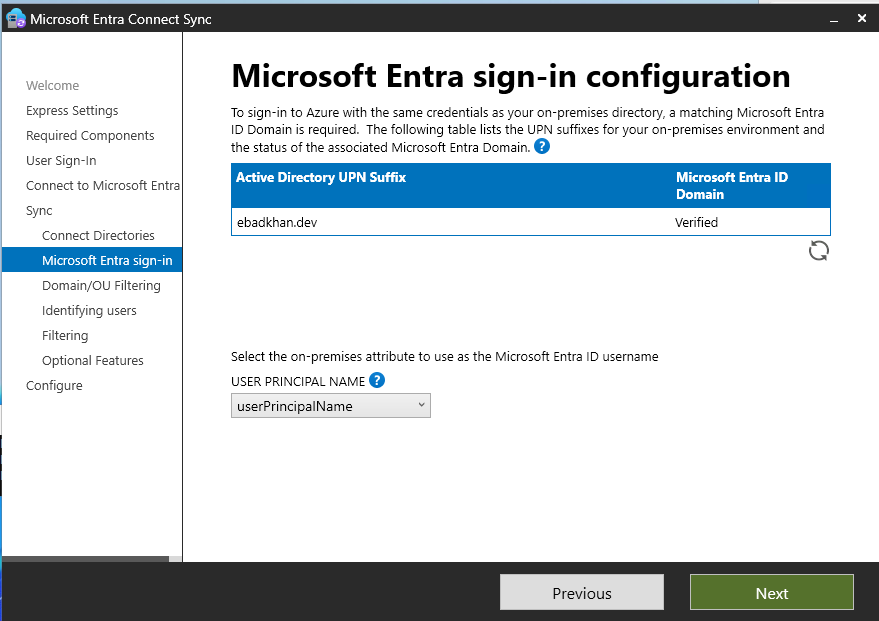

Side note: whoever controls your registrar account can verify your domain into *their* tenant. Put MFA on your registrar.

### OU filtering (the screen that actually matters)

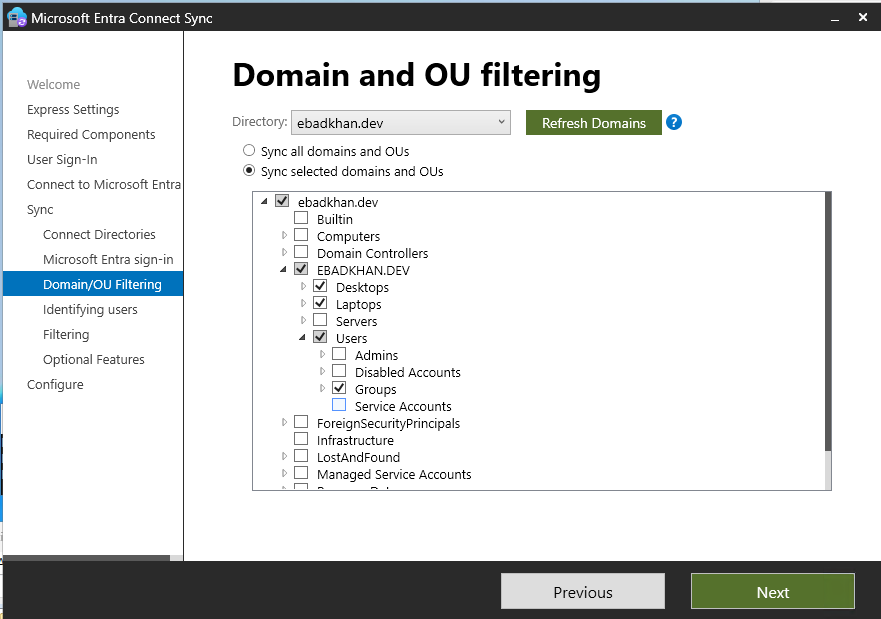

Desktops, Laptops, Users (minus Admins, Disabled, and Service Accounts), and Groups. Also worth knowing: if a parent OU is ticked, **new child OUs sync automatically.** That's how admin accounts can leak into Entra six months later.

### Source anchor

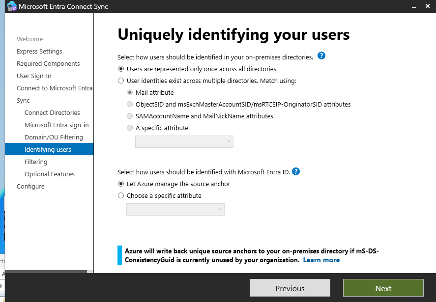

Continue.

### Optional features

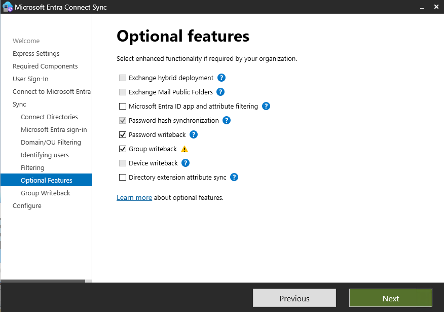

Both turn sync from one-way (AD to cloud) into two-way. 
I would not recommend this. A compromised cloud admin can now write into your domain. Group writeback is also on its way out (hence the warning icon), so I turned it off completely. I did end up keeping password writeback for self-service password reset, but on purpose.

## Step 2: Hybrid join (or, where's my device?)

Users and groups showed up in Entra. WIN-DESK didn't. This ended up being my favorite part of the night.

Computers don't sync just because they live in a synced OU. Here's the actual flow:

1. Connect writes a **Service Connection Point (SCP)** into AD. It tells domain-joined machines which tenant to join.
2. The device runs a scheduled task called `Automatic-Device-Join`, reads the SCP, generates a self-signed cert, and writes it to its own computer object's `userCertificate` attribute.
3. Connect **only syncs computers that have a `userCertificate`.**
4. After the next sync, the device finishes joining on the next sign-in.

I had never done step 1. Confirmed:

```powershell
Get-ADObject "CN=62a0ff2e-97b9-4513-943f-0d221bd30080,CN=Device Registration Configuration,CN=Services,CN=Configuration,DC=ebadkhan,DC=dev" -Properties keywords
# Directory object not found
```

The SCP lives in the Configuration partition, which replicates to every DC in the forest. That's why writing it needs **Enterprise Admin** and not just Domain Admin. It's done from Connect under Configure device options:

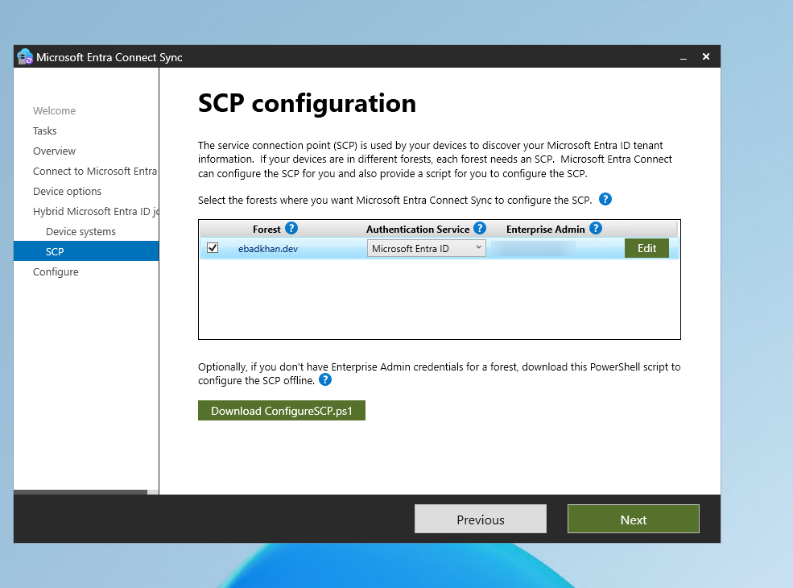

After a reboot, the cert showed up on the computer object. Here's the coolest thing I found all night. When I dumped `userCertificate`, it came back as a giant wall of decimal numbers. Reading a chunk of them as ASCII, they spelled out the **exact device ID** that `dsregcmd` had been complaining about in its `error_missing_device` message. The cert's subject *is* the device ID. That's how Entra matches "the device trying to join" with "the object Connect synced up."

```powershell
$c = (Get-ADComputer WIN-DESK -Properties userCertificate).userCertificate[0]
[System.Security.Cryptography.X509Certificates.X509Certificate2]::new($c) | fl Subject, Issuer, NotAfter
```

Subject and issuer are the same, so it's self-signed. The trust doesn't come from a CA. It comes from the fact that the device was able to write to its own AD object.

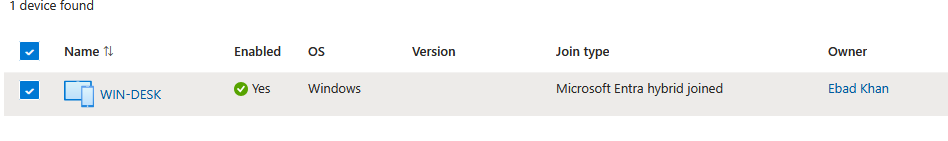

YAY! Hybrid joined.

## Step 3: Getting into Intune

**Hybrid join is not enrollment.** 
Joining is identity (Entra knows and trusts the device). Enrolling is management (Intune can actually push stuff to it). For a hybrid device, something has to trigger the enrollment, either a GPO or the ConfigMgr client with co-management turned on.

I started with automatic enrollment in Intune:

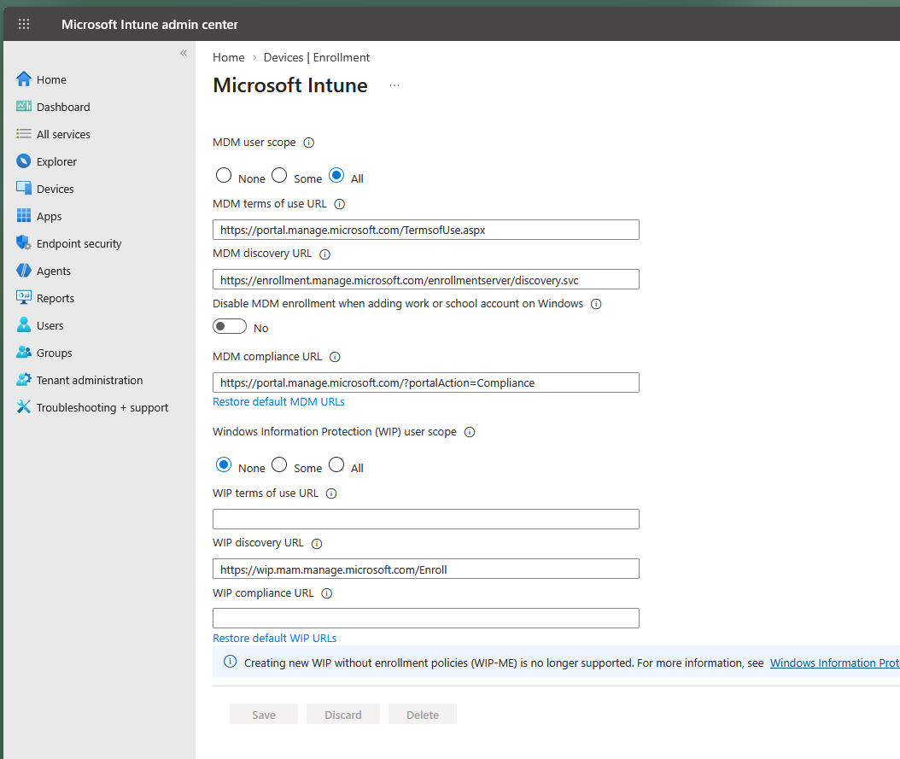

I also set WIP scope to **None**. WIP is retired, and leaving it on can push devices into app-only management instead of full MDM. Not a fun one to debug.

Then the auto-enroll GPO, linked to my Desktops OU:

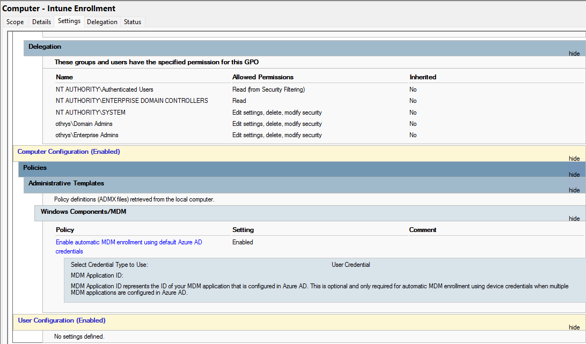

The GPO creates a scheduled task under `\Microsoft\Windows\EnterpriseMgmt\`. Heads up: you won't see it unless Task Scheduler is running as admin, since the task runs as SYSTEM. I stared at an empty folder for a solid minute before figuring that out.

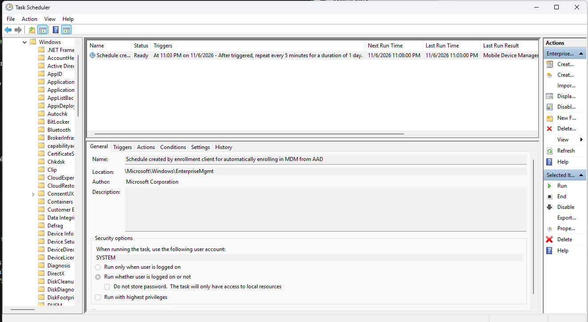

And then the error codes started rolling in.

### 0x80180031: MDM not configured

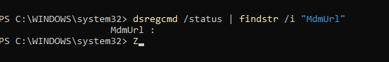

The device gets its MDM enrollment URLs **during the join** and caches them. Mine joined before I'd finished setting up Intune, so it cached "no MDM." Changing settings in the portal afterward doesn't update what the device already has. Running `dsregcmd /refreshprt`, then signing out and back in, fixed it:

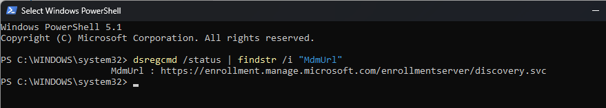

### 0x80180026: management blocked

Next one. A quick registry check told the story:

```
HKLM\SOFTWARE\Microsoft\Enrollments   ExternallyManaged = 1
CcmExec                               Running
```

The CM client from my last post was already on the box. Without co-management, it marks Windows as "externally managed" so Intune stays out. Windows doesn't want two management tools fighting over one device, which honestly is fair.

In newer versions of MECM, the node is called **Cloud Attach**:

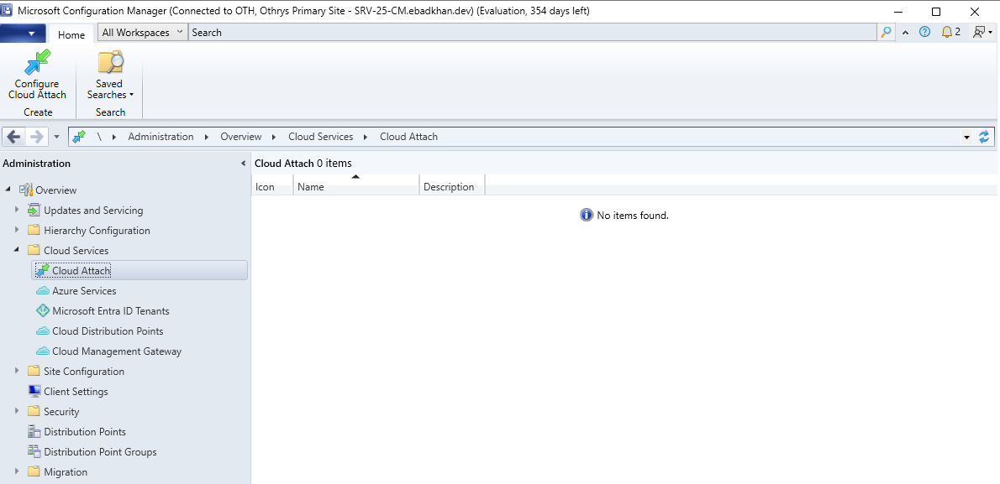

Pick **Customize** in the wizard, not the recommended settings. Recommended turns on auto-enrollment and data upload for everything at once. I made a `CoMgmt-Pilot` collection with just WIN-DESK in it, scoped enrollment to that, and left every workload on ConfigMgr for now.

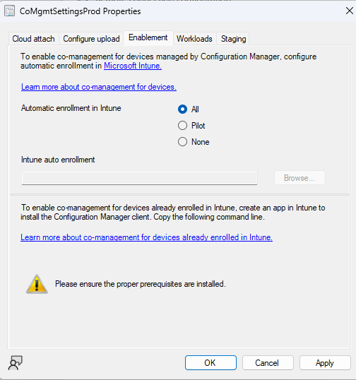

`CoManagementHandler.log` confirmed the policy landed, then told me something I didn't know:

```
Queuing enrollment timer to fire at 11/07/2026 14:09:10 local time
```

CM **randomizes** enrollment on purpose, so 10,000 machines don't slam Intune at the same second. It wasn't broken, it was just waiting its turn. I was not patient, so I cleared the `ExternallyManaged` flag and kicked the task myself. (Lab only. Don't make this a habit at work.)

### 0x80180003: not authorized (the long one)

License: good. MDM scope: All. Enrollment restrictions: Windows allowed. Intune's troubleshooting page: **zero** enrollment failures. So why was Intune telling me no?

I chased MFA for a while, because the AAD Operational log was full of `AADSTS50076` errors (MFA required), including one for `enrollment.manage.microsoft.com`. I even turned Security Defaults off to test it. Still `0x80180003`. Wrong rabbit hole.

What finally cracked it was pulling the full diagnostic bundle instead of guessing from symptoms:

```powershell
MdmDiagnosticsTool.exe -area DeviceEnrollment -cab C:\temp\mdm.cab
```

Inside the enrollment event log was the server's actual answer:

```
Event 52: Authorization | MDM Authority Not Defined
Event 76: 0x80180003
```

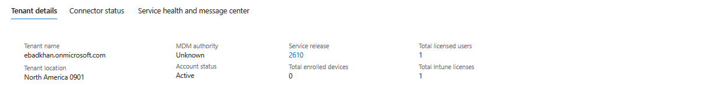

**MDM authority: Unknown.** My tenant had never actually been told that Intune manages devices. lol. Normally this gets set automatically the first time someone opens Intune. In my tenant it never happened, and there was no banner anywhere to set it. So, Graph Explorer it is:

```
POST https://graph.microsoft.com/beta/organization/<tenant-id>/setMobileDeviceManagementAuthority
```

You'll need to consent to `DeviceManagementServiceConfig.ReadWrite.All` first. 

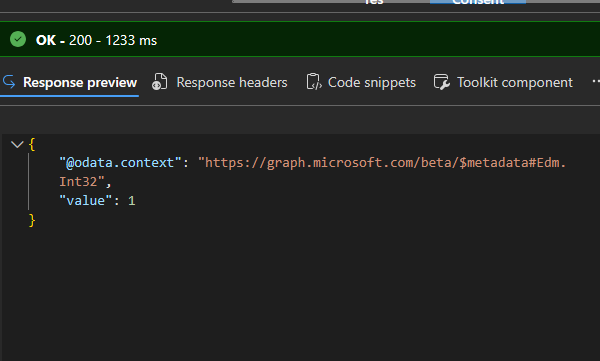

`"value": 1` means Intune (0 is unknown, 1 is Intune, 2 is ConfigMgr, 3 is Office 365).

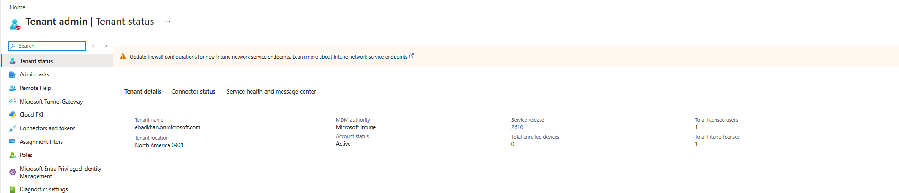

Ran the task one more time, and it enrolled!

## It works!

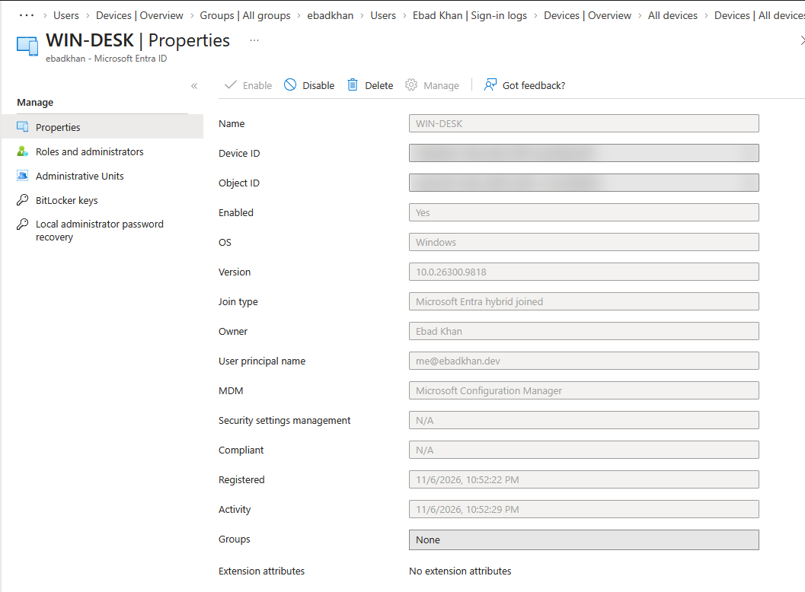

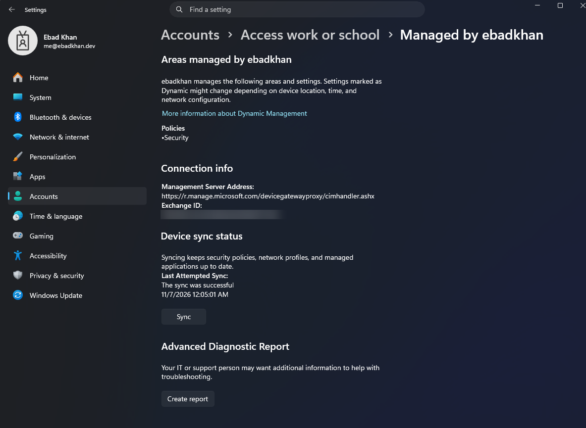

That management server address, `r.manage.microsoft.com`, is Intune's device gateway. Last sync: successful.

### Bonus: the duplicate device

Right after enrolling, WIN-DESK showed up **twice** in Intune:

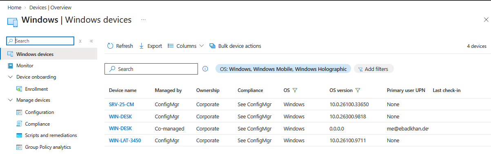

The "ConfigMgr" row with no user came from Cloud Attach's **upload** feature (also called tenant attach), which pushes CM's device records to Intune. The "Co-managed" row was the real enrollment. Running both at the same time is a known way to get duplicates. Co-management doesn't need upload at all, so I unchecked **Upload to Microsoft Intune admin center** in the Cloud Attach properties.

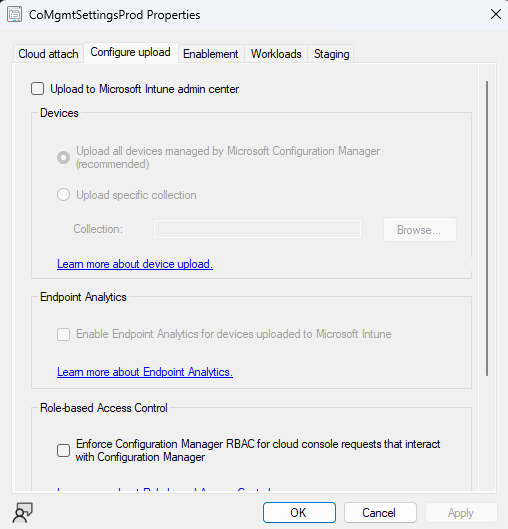

About half an hour later:

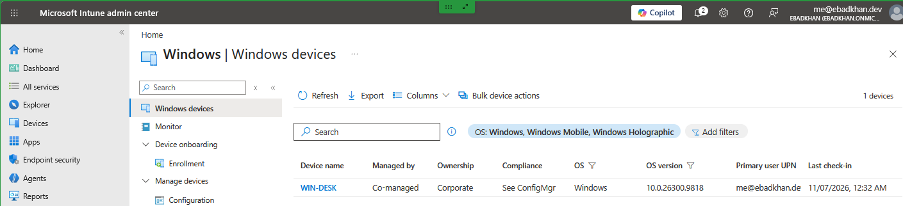

One record. Co-managed. Primary user set. Just know that turning off upload also removes the ConfigMgr actions from the Intune portal, so if you want to run CM actions from the cloud, you'll have to live with the duplicates.

## Error code cheat sheet

| Code | What it means | What it was for me |
| --- | --- | --- |
| `error_missing_device` | Entra has no device object with this ID yet | Device hadn't synced up yet |
| `0x80070005` on sync | Access denied | Stale token. Group was added after I logged in |
| `0x80180031` | MDM not configured | Device cached "no MDM" at join time |
| `0x80180026` | Device management blocked | CM client marked the device as externally managed |
| `0x8018002A` | Couldn't get a token | MFA prompt a background task can't show |
| `0x80180003` | User not authorized | **MDM authority was never set on the tenant** |


## Fin

WIN-DESK is now hybrid joined and co-managed, and every workload still lives in ConfigMgr. Next time, I'll set up a break-glass account (always before touching Conditional Access), move the compliance workload over to Intune, and build a policy that requires a compliant device. Stay tuned!
